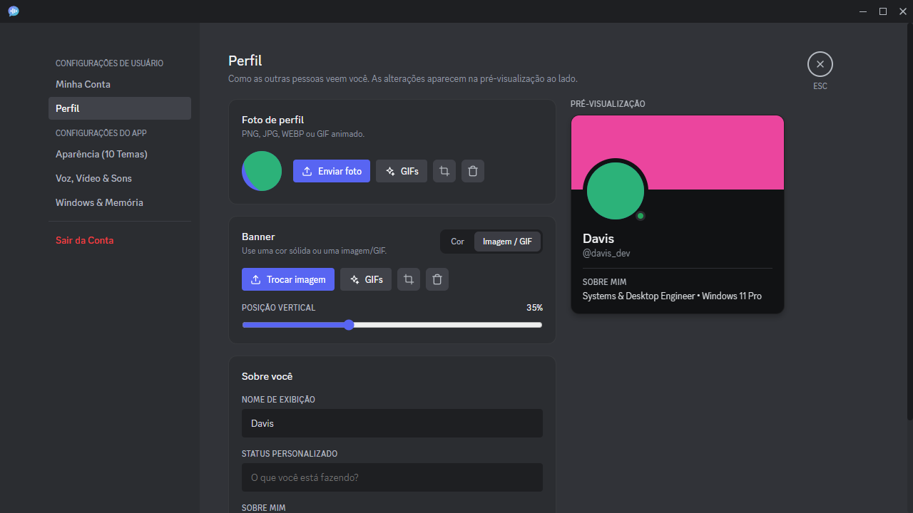

# Invadominio zak' zak — cliente de chat e voz (Discord REA)

Aplicativo desktop de chat, voz e compartilhamento de tela inspirado no Discord, feito em **Electron** com backend próprio em **SQLite**. Projeto pessoal, sem vínculo com a Discord Inc.



## Funcionalidades

- Servidores com categorias e canais de texto e voz editáveis, convites com link próprio (com botão que abre o app), expulsar e banir membros, apagar servidor
- Cargos de verdade: permissões aplicadas pelo servidor (enviar mensagens, arquivos, links, reações, gerenciar mensagens/canais/cargos, falar, transmitir...), permissões de @everyone, cor do cargo no nome e pesquisa de cargos
- Mensagens diretas, pedidos de amizade por `@username`, chamadas de voz na DM (toca, atende, recusa)
- Chat com menções por `@` (lista de sugestões no chat e no chat da call; a menção abre o card da pessoa), links clicáveis, reações com todos os emojis (os mais usados primeiro), "fulano está digitando...", menu de botão direito na mensagem (responder, editar, excluir)
- Compartilhamento de tela em vídeo de verdade (WebRTC, até 1440p/120 FPS, com som do PC), câmera, indicador de quem está falando
- Atividade no perfil: o jogo que você está jogando (com o ícone do app e o tempo) e a música do Spotify, com capa e barra de progresso
- Sons de entrar, sair, chamando e notificação
- Perfil com foto e banner (inclusive GIF), tema em gradiente, editor de enquadramento e biblioteca de GIFs (Giphy)
- Conta com verificação de e-mail por código (Supabase + Brevo, grátis), troca de senha e sessões seguras
- Colar imagem no chat (Ctrl+V), editar anexo (nome/spoiler), ampliar e salvar imagens e arquivos, bolinha vermelha de mensagens não lidas, fechar DMs
- Barras laterais com largura ajustável, janela de transmissão móvel e redimensionável
- Tamanho da interface e do texto ajustáveis, 10 temas visuais e atualização pelo próprio app
- Fluido por padrão: transmissão mantendo o FPS (baixa a nitidez quando falta CPU ou banda), prioridade acima do normal durante calls e memória devolvida ao Windows quando o app está minimizado; o **Modo economia de memória** (Configurações → Windows & Memória) mantém o app abaixo de ~80 MB, com o custo de travadas ocasionais
- Menu de botão direito no cartão da call: perfil, mensagem, nota, volume por pessoa, silenciar só para você, efeitos sonoros, vídeo, amigo, bloquear, cargos, mover, e moderação (silenciar voz e desativar áudio no servidor, desconectar)

---

## Só quero usar o app

No **PowerShell** (tecla Windows → digite `powershell` → Enter), cole:

```powershell
irm https://129-159-51-96.sslip.io/download/install.ps1 | iex
```

Isso baixa o app do servidor, confere o arquivo, instala em `%LOCALAPPDATA%\Invadominio`, cria o atalho **Invadominio zak' zak** na Área de Trabalho e no Menu Iniciar e abre o app. Não precisa de administrador nem de Node.js.

**Atualizar:** o app avisa quando sai uma versão nova; em *Configurações → Windows & Memória → Atualizações* clique em **Atualizar agora** (ou rode o mesmo comando de novo). Suas contas não são apagadas.

As seções abaixo são para quem vai **desenvolver** o app.

---

## 1. Requisitos

| Item | Versão |
| --- | --- |
| Windows | 10 ou 11 (x64) |
| [Node.js](https://nodejs.org/) | 18 ou mais recente (inclui o `npm`) |
| [Git](https://git-scm.com/) | qualquer versão recente |

> O Electron é baixado automaticamente pelo `npm install`; não é preciso instalá-lo à parte.

## 2. Instalação

Abra o **PowerShell** (ou o Terminal) e rode:

```powershell
git clone https://github.com/davisantanadev/discord-rea.git
cd discord-rea
npm install
```

O `npm install` baixa cerca de 300 MB (Electron incluso) e pode levar alguns minutos.

## 3. Abrir o app

```powershell
npm start
```

A tela de carregamento aparece e em seguida a janela principal. Para pular a tela de carregamento:

```powershell
npx electron . --skip-splash
```

### Primeiro acesso

Na primeira execução o app cria uma conta de administrador e um servidor de exemplo:

| E-mail | Senha |
| --- | --- |
| `davis@discord.local` | `password123` |

Entre com ela **e troque a senha** em *Configurações → Minha Conta → Senha*. Você também pode criar novas contas pela opção **Cadastrar** na tela de login.

## 4. Configuração

O app funciona sem nenhuma chave extra. A verificação de e-mail já vem ligada a um projeto Supabase (ver 4.2); a biblioteca de GIFs precisa de uma chave grátis do Giphy.

### 4.1. Chave do Giphy (arquivo local)

Chaves secretas ficam num arquivo `app.config.local.json` que **nunca** vai para o GitHub nem para dentro do `.exe`. O app procura esse arquivo em dois lugares:

| Onde | Quando usar |
| --- | --- |
| `%APPDATA%\Eco\app.config.local.json` | App instalado (`.exe`) — e também funciona com `npm start` |
| `app.config.local.json` na pasta do projeto | Desenvolvimento (`npm start` / `npm test`) |

```powershell
Copy-Item app.config.local.example.json "$env:APPDATA\Eco\app.config.local.json"
notepad "$env:APPDATA\Eco\app.config.local.json"
```

```json
{ "giphyApiKey": "SUA_CHAVE_DO_GIPHY" }
```

Chave grátis em [developers.giphy.com](https://developers.giphy.com/) → *Create an App* → *API*. Sem ela, a biblioteca mostra GIFs gerados localmente.

### 4.2. Verificação de e-mail (Supabase + Brevo, grátis)

O código de 6 dígitos é gerado, enviado e conferido pela função **`email-otp`** do Supabase (`supabase/functions/email-otp`), que envia pelo **Brevo** (300 e-mails/dia grátis). O app só chama a função; o código fica guardado no Supabase como hash (tabela `email_otps`, migração em `supabase/migrations`).

No `app.config.json` ficam apenas a URL do projeto e a **chave publicável** (`sb_publishable_...`) — pública por natureza, então o app já sai configurado para todo mundo. A chave do Brevo fica só nos segredos da função.

```json
"supabase": {
  "url": "https://SEU-PROJETO.supabase.co",
  "publishableKey": "sb_publishable_..."
}
```

Sem `supabase` configurado, o app entra em *modo desenvolvimento*: o código aparece na própria tela.

#### Passo 1 — Conta no Brevo

1. Crie uma conta grátis em [brevo.com](https://www.brevo.com/) e complete o perfil.
2. Em **Senders, Domains & Dedicated IPs → Senders → Add a sender**, cadastre o remetente (ex.: nome `Eco`, seu e-mail) e confirme pelo link que o Brevo envia.
3. Em **SMTP & API → API Keys → Generate a new API key**, crie uma chave (começa com `xkeysib-`) e copie.

#### Passo 2 — Segredos da função no Supabase

Em *Supabase → Edge Functions → Secrets* (ou *Project Settings → Edge Functions*), adicione:

| Nome | Valor |
| --- | --- |
| `BREVO_API_KEY` | a chave `xkeysib-...` |
| `BREVO_SENDER_EMAIL` | o e-mail confirmado como remetente no Brevo |

Pronto: em *Configurações → Minha Conta → Verificar*, o código chega por e-mail. Limites da função: 1 código por minuto e 5 por hora para cada e-mail, até 250 por dia no total.

#### Publicar a função num projeto novo

Com a [Supabase CLI](https://supabase.com/docs/guides/cli):

```powershell
supabase link --project-ref SEU-PROJETO
supabase db push
supabase functions deploy email-otp --no-verify-jwt
```

Para exigir e-mail verificado para usar o app, ponha `"requireVerifiedEmail": true` no `app.config.json`.

### 4.3. Configurações gerais — `app.config.json`

| Campo | O que faz |
| --- | --- |
| `appName` | Nome mostrado nos convites e e-mails |
| `publicUrl` | Endereço público (ex.: `https://eco.seudominio.com`). Vazio = `http://127.0.0.1:<porta>`, que só funciona neste PC |
| `invitePath` | Caminho dos links de convite (padrão `/convite`) |
| `requireVerifiedEmail` | `true` = só entra no app quem confirmou o e-mail |
| `supabase.url` / `supabase.publishableKey` | Projeto Supabase cuja função `email-otp` envia os códigos |

### 4.4. Hospedar o servidor (para usar com amigos)

Com `serverUrl` preenchido no `app.config.json`, o app **não** abre um servidor local: todos se conectam ao mesmo servidor.

O servidor é o próprio backend rodando sozinho (`npm run server`, sem Electron). A instalação atual:

| Item | Valor |
| --- | --- |
| Máquina | Oracle Cloud Always Free (Ubuntu 24.04), São Paulo |
| Endereço | `https://<IP-com-hífens>.sslip.io` (HTTPS automático pelo Caddy + Let's Encrypt) |
| Código | `/opt/eco` (dono `root`) |
| Dados | `/var/lib/eco` — banco, uploads e `app.config.local.json` (chave do Giphy) |
| Serviço | `systemctl status eco` (usuário `eco`, reinicia sozinho) |
| Logs | `journalctl -u eco -f` |

Variáveis do serviço: `APP_PUBLIC_URL`, `REQUIRE_VERIFIED_EMAIL=1`, `TRUST_PROXY=1`, `ECO_DATA_DIR=/var/lib/eco`. No servidor a conta de exemplo **não** é criada, e logins/cadastros têm limite de tentativas.

Na Oracle, a *Security List* da sub-rede precisa liberar **TCP 80 e 443** (entrada de `0.0.0.0/0`), e o firewall do Ubuntu também (regras `iptables` antes do `REJECT`, salvas com `netfilter-persistent`).

**Voz nas calls (WebRTC):** o áudio vai direto entre os PCs (criptografado); o servidor só repassa as mensagens de conexão, e apenas para o destinatário. Para redes que não permitem conexão direta (CGNAT), o mesmo servidor roda um relay **TURN** (`coturn`, `/etc/turnserver.conf`) com credenciais temporárias de 12 h assinadas pelo Eco a partir de `turn.secret` em `/var/lib/eco/app.config.local.json` — o segredo nunca vai para o app. Portas extras a liberar na Security List e no `iptables`: **UDP 3478, TCP 3478 e UDP 49160–49200**.

Para publicar uma nova versão do app para download: aumente `version` no `package.json`, rode `npm run build:exe`, envie o zip de `dist\Discord-win32-x64` como `/var/www/eco-download/Eco.zip`, regenere o checksum com `sha256sum Eco.zip > Eco.zip.sha256` e atualize `/var/www/eco-download/version.json` (`{"version": "1.1.0", "notes": "..."}`) — é esse arquivo que o botão **Verificar atualizações** do app consulta. O instalador fica em `scripts/install.ps1` (servido em `/download/install.ps1`).

**Vídeo nas calls:** tela e câmera vão pela mesma conexão WebRTC da voz (H.264 por hardware quando a placa suporta), na resolução e FPS escolhidos, com taxa de bits proporcional (1080p a 60 FPS ≈ 9 Mbps por pessoa assistindo). Se a internet não aguentar, o WebRTC ajusta sozinho.

Para atualizar o código no servidor:

```bash
tar czf - electron scripts/server.js assets/audio app.config.json package.json | ssh -i ~/.ssh/eco-server.key ubuntu@SEU-IP "sudo tar xzf - -C /opt/eco && sudo systemctl restart eco"
```

## 5. Gerar o executável (.exe)

```powershell
npm run build:exe
```

Isso cria:

- `dist\Discord-win32-x64\Discord.exe` — o app completo empacotado
- Um atalho na sua **Área de Trabalho** com o nome do `appName` do `app.config.json` (`Invadominio zak' zak`) que abre o app acima (use `$env:DESKTOP_DIR="C:\outra\pasta"` para mudar o local)

> Feche o app antes de rodar o build, senão a pasta `dist` fica travada (erro `EBUSY`).

## 6. Testes automatizados

```powershell
npm test
$env:VERIFY_REMOTE = "1"; npm test   # mesma suíte falando com o servidor por HTTP, como no modo hospedado
```

Roda as suítes de ponta a ponta dentro do Electron (login, servidores, chamadas, sons, convites, conta etc.) usando um banco temporário — seus dados não são tocados. O resultado fica em `docs/verification-results.json`.

## 7. Onde ficam os dados

O nome do app (janelas, atalhos, executável, Gerenciador de Tarefas, convites e e-mails) vem de `appName` no `app.config.json`; o nome dos e-mails fica em `APP_NAME` na função `supabase/functions/email-otp`. A pasta de dados manteve o nome interno `Eco`, para ninguém perder o login ao atualizar.

Banco de dados, uploads e configurações locais ficam em:

```
%APPDATA%\Eco
```

Para começar do zero, feche o app e apague essa pasta.

## 8. Estrutura do projeto

```text
electron/
  main.js              Processo principal (janelas, bandeja, IPC)
  backendServer.js     Backend HTTP + SQLite + eventos em tempo real
  appConfig.js         Leitura do app.config.json / app.config.local.json / variáveis
  accountDelivery.js   Códigos de verificação por e-mail (função email-otp do Supabase)
  gifLibrary.js        Busca de GIFs no Giphy
src/
  index.html, app.js   Interface
  state/store.js       Estado do app e chamadas ao backend
  services/            Áudio, dispositivos, compartilhamento de tela
  styles/              Temas e estilos
assets/                Ícone, sons, fontes e tela de carregamento
scripts/               Build do .exe e testes automatizados
supabase/              Função email-otp e migração do banco (Supabase)
docs/                  Relatório técnico e capturas de tela
```

## 9. Problemas comuns

| Sintoma | Solução |
| --- | --- |
| `EBUSY: resource busy or locked` no build | Feche o app (inclusive pelo ícone na bandeja) e rode de novo |
| GIFs não carregam do Giphy | Confira a `giphyApiKey` no `app.config.local.json` |
| Link de convite não abre em outro PC | Defina `publicUrl` com o endereço onde o app está hospedado |
| Não recebo o código por e-mail | Confira a pasta de spam e os segredos `BREVO_API_KEY` / `BREVO_SENDER_EMAIL` da função (4.2) |
| "O envio de e-mail ainda não foi configurado no servidor" | Faltam os segredos da função `email-otp` no Supabase (4.2, passo 2) |
| Esqueci a senha da conta inicial | Feche o app e apague `%APPDATA%\Eco` para recriar a conta padrão (apaga todos os dados) |
